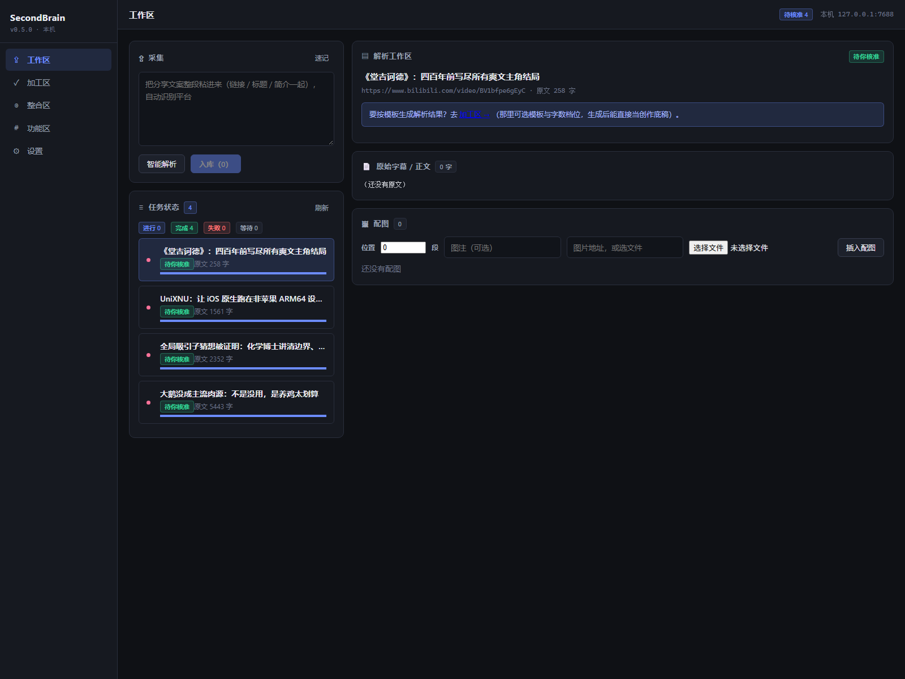

# SecondBrain

> 自用优先的**个人知识库**：采集 → 提炼 → 创作 → 运维，跑在自己的机器上。

桌面常驻服务 + 本机浏览器界面（`http://127.0.0.1:7688`），数据全部落在本机：
Markdown 是唯一真相源，SQLite 只做索引、随时可重建。服务默认只监听回环地址
（`web.allow_lan` 可显式开启局域网访问）；采集原文与调用 AI 时才按需联网。



```
A 进货  →  B 提炼  →  C 创作  →  D 运维
（原文）    （AI 摘要 + 手稿）  （笔记）    （回顾 / 标签 / 归档）
```

## 下载

Windows 免安装版（解压后双击 `SecondBrain.exe`，不需要装 Python）：

**<https://github.com/louisbond/SecondBrain-v0/releases/latest>**

首次运行会在 `~/.secondbrain/` 建库，数据不出本机；想用自己的 Obsidian 库，
在「设置 → 采集与存储 → Vault 目录」改一行即可。完整操作见包内 `使用说明.md`。
未做代码签名，首次运行 SmartScreen 会提示「未知发布者」→ 更多信息 → 仍要运行。

核心原则：**AI 起草、人工逐条核准**。AI 给的是草稿，进不进知识库由人决定。

---

## 这个仓库里有什么

| 目录 | 内容 |
|---|---|
| `secondbrain/backend` | FastAPI + SQLite（FTS5 全文检索），领域逻辑与接口 |
| `secondbrain/frontend` | Vue 3 + Vite + Vditor，四个工作区（采集 / 加工 / 原创 / 设置） |
| `secondbrain/scripts` | 一键检查脚本 `check.py`（14 项：lint / 类型 / 单测 / 契约 / 构建 / 浏览器类检查） |
| `secondbrain/deploy` | Windows 打包与部署脚本（PyInstaller） |
| `secondbrain/docs` | [用户使用说明](secondbrain/docs/USER_GUIDE.md) |

开发、构建、测试的完整说明在 **[secondbrain/README.md](secondbrain/README.md)**。

## 快速开始（开发态）

```bash
cd secondbrain/backend && python -m pip install -r requirements.txt
cd ../frontend && npm install && npm run build
cd ../backend && python run.py        # → http://127.0.0.1:7688
```

要求 Python 3.13、Node 22（Windows 为当前主要目标平台）。

## 质量门禁

```bash
cd secondbrain && python scripts/check.py          # 全套 14 项
cd secondbrain && python scripts/check.py --ci     # 平台无关的 9 项（CI 用的就是这套）
```

CI 跑在 GitHub 托管的 Ubuntu 上，只覆盖平台无关项；依赖真实 Edge 与本机服务的
5 项浏览器检查留在 Windows 本地/self-hosted runner（见 `.github/workflows/`）。

## 状态与边界

- 版本 **v0.7.0**，个人自用优先，接口与数据表仍可能变动。
- 目前只针对 Windows 分发（PyInstaller 单目录包）；源码在 Linux 上可通过 lint / 类型 / 单测。
- AI 能力需要自备模型或 API Key，程序不内置任何密钥。
- 本仓库不含任何个人数据：`data/`（数据库、音频缓存、模型权重）已被 `.gitignore` 排除。

## 许可

MIT，见 [LICENSE](LICENSE)。第三方组件与许可证见 [THIRD_PARTY_NOTICES.md](THIRD_PARTY_NOTICES.md)。
