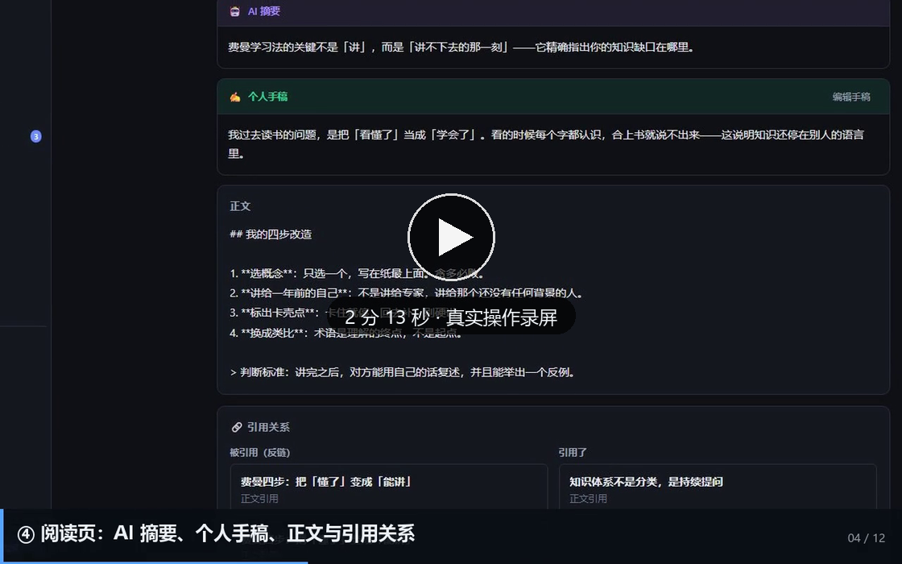
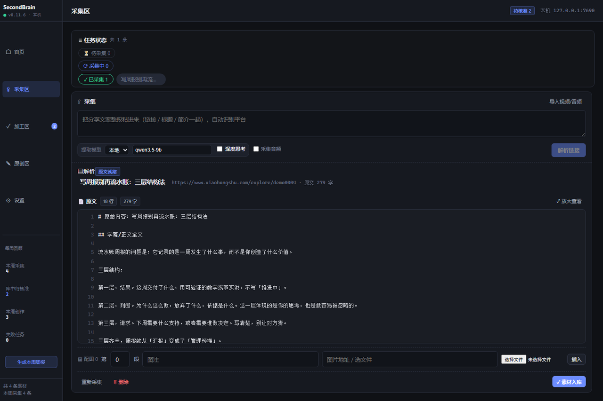
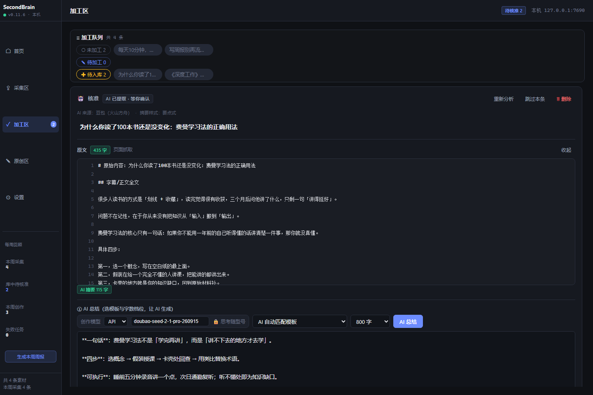
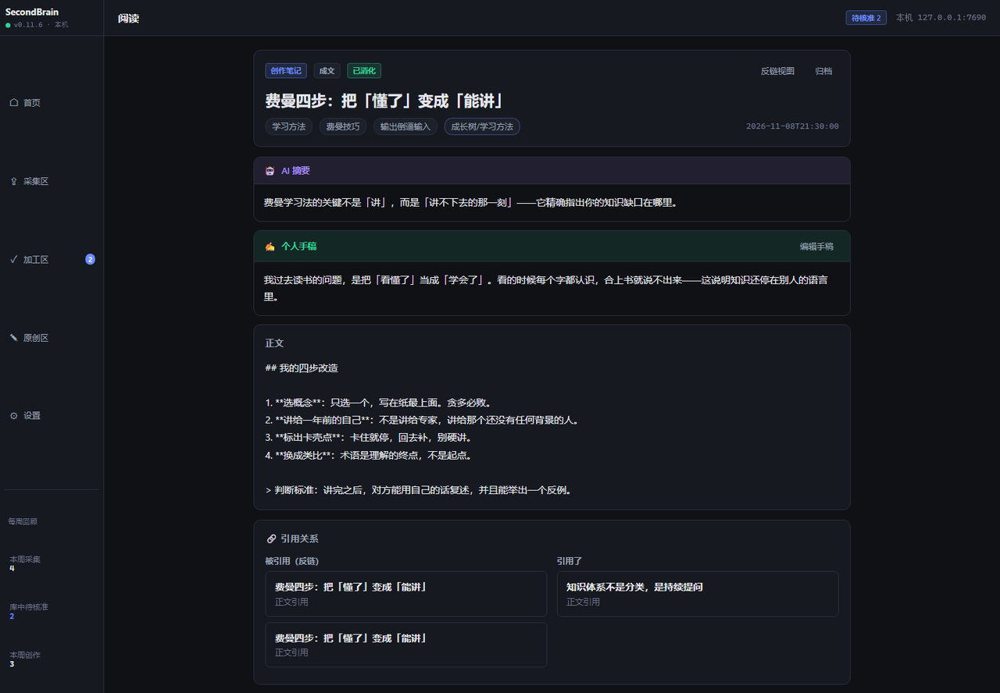
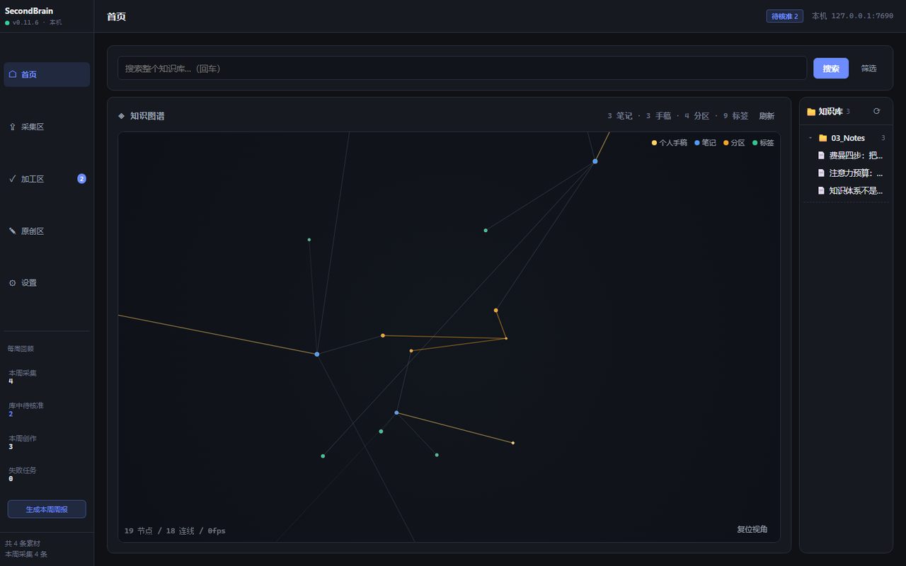

# SecondBrain

一个跑在你自己电脑上的个人知识库，只做一件事：

**把视频/文章变成你的经验。** 粘贴分享链接 → 程序自动抓正文、转写口播、
生成 AI 摘要 → 你在精读区核内容、写下自己的想法 → 编入经验树。
以后在知识图谱里回看、更新自己的创作。

技术栈：FastAPI 后端 + Vue 前端，PyInstaller 打包，默认只监听
`127.0.0.1:7688`。**Markdown 文件是唯一真相源**，SQLite 只是可随时重建的索引 ——
就算不用这个软件，你的笔记用 Obsidian 照样能打开。

[](https://cdn.jsdelivr.net/gh/louisbond/SecondBrain-v0@e980866/secondbrain/docs/assets/release/v0.11.6/demo.mp4)

<sub>▶ 点封面播放（2 分 13 秒，无声，约 6.7 MB）· 真实鼠标操作录屏，未做拼接 · [下载 MP4](https://github.com/louisbond/SecondBrain-v0/blob/main/secondbrain/docs/assets/release/v0.11.6/demo.mp4)</sub>

| 采集 | 加工 |
| --- | --- |
|  |  |
| **阅读（AI 摘要 + 个人手稿）** | **经验树** |
|  |  |

---

## 下载与运行（Windows）

去 [Releases](../../releases) 下载 `v0.11.6`：

| 文件 | 说明 |
| --- | --- |
| `SecondBrain-v0.11.6-win64-app.zip` | **主程序**，解压后双击 `SecondBrain.exe` 即可 |
| `SecondBrain-v0.11.6-win64-models.zip` | 可选：本地 AI 模型（语音转写 + 相关笔记推荐）。不装也能用，在设置里选 API 模型（如 Doubao）即可 |
| `SecondBrain-v0.11.6-source.zip` | 完整源码快照 |

装模型时把压缩包里的 `data/` 解压到主程序同一目录，保持目录结构一致。

首次运行会在本机创建数据库和配置文件。局域网访问默认关闭，需要在设置里显式开启
（开启时会自动生成访问令牌）。

> 发布包不含任何密钥、账号配置、笔记内容、日志或音频缓存。

## 从源码运行

```bash
# 后端
cd backend
python -m pip install -r requirements.txt
python run.py

# 前端（另一个终端）
cd frontend
npm install
npm run dev
```

后端配置见 `config/config.example.toml`：复制成 `config.toml` 后按需修改。
密钥放在 `config/secrets.json`，这两个文件都不会被提交进仓库。

## 界面

- **首页**：知识图谱 + 文件树，看自己的经验长成了什么样
- **采集区**：粘贴链接，抓取原文与口播转写
- **加工区**：原文 + AI 摘要，写手稿、定标签分区、入库
- **原创区**：从空模板写日记、周回顾、知识提炼
- **设置**：模型、提示词、索引维护、VAULT 目录

## 数据在哪

默认在你的 Obsidian 库目录（`config.toml` 里的 `vault.path`）：

```
01_Inbox/      A 层：采集到的原文
02_Processed/  B 层：AI 摘要 + 你的手稿
03_Notes/      C 层：原创笔记
```

## 许可

MIT，见 [LICENSE](LICENSE)。第三方组件见
[THIRD_PARTY_NOTICES.md](THIRD_PARTY_NOTICES.md)。

面向开发者的旧版说明在 [`secondbrain/README.md`](secondbrain/README.md)，
完整使用说明见 [`secondbrain/docs/USER_GUIDE.md`](secondbrain/docs/USER_GUIDE.md)。
